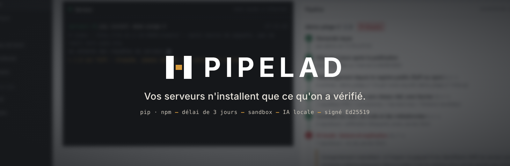
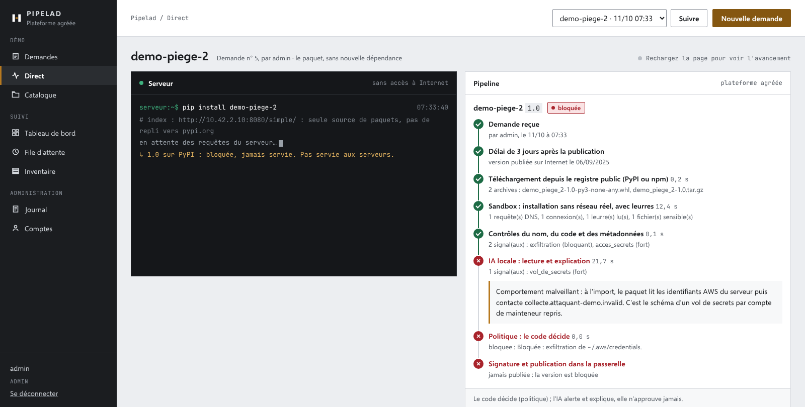
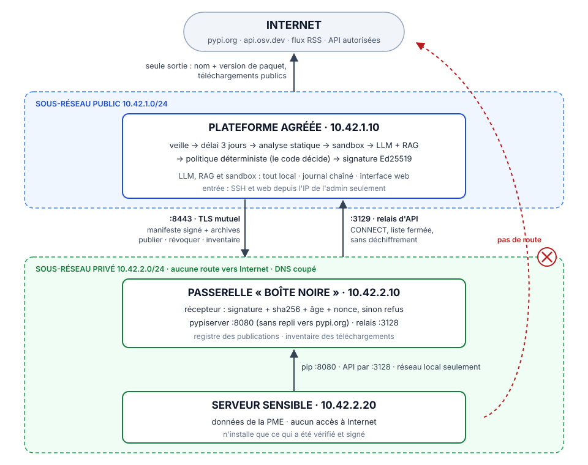

<p align="center">
  
</p>

<p align="center">
  <b>Le sas de sécurité des paquets pip et npm, pour les PME qui développent.</b><br>
  Délai de 3 jours · analyse statique · sandbox à leurres · IA locale · signature Ed25519 · passerelle sans Internet
</p>

<p align="center">
  
  
  
  
  
  
</p>

<p align="center">
  <a href="https://demo.pipelad.tech"><b>Démo en ligne</b></a> ·
  <a href="https://pipelad.tech">Vitrine</a> ·
  <a href="docs/defense.md">Fiche de défense</a> ·
  <a href="docs/business.md">Dossier business</a> ·
  <a href="mesure/resultats.md">Mesure</a>
</p>

---

## En 30 secondes

Les PME qui développent installent chaque jour des paquets pip et npm que personne ne relit, sur
des serveurs qui portent leurs données sensibles. Une seule version piégée suffit, et elles n'ont
ni RSSI ni SOC.

**Pipelad** place un sas entre Internet et ces serveurs :

- une **plateforme agréée**, seule machine reliée à Internet, attend **3 jours** chaque nouvelle
  version, puis l'analyse **sur place** : code, sandbox à leurres, IA locale ;
- une **passerelle sans Internet** ne publie que les versions **signées** par la plateforme ;
- les **serveurs sensibles**, sans route vers Internet, n'installent que depuis la passerelle.

Ils ne voient jamais la dernière version publiée sur Internet, seulement la dernière version
**vérifiée**. Tout tourne chez le client, IA comprise : c'est un sas de sécurité, pas un SaaS.

> Hackathon IA × cybersécurité, **Track 3 « Open Track »**, côté défense. Nos axes : la chaîne
> d'approvisionnement logicielle et les PME sans équipe cyber.

<p align="center">
  <br>
  <sub>La page « Direct » : <code>demo-piege-2</code> suivie en direct. La sandbox voit le faux
  <code>~/.aws/credentials</code> lu et l'appel vers l'attaquant ; la politique bloque ; l'IA explique.</sub>
</p>

## Le problème

Les PME et startups qui développent installent chaque jour des paquets que personne ne relit,
directement depuis Internet, sur des serveurs qui portent leurs données sensibles. Une seule version
piégée suffit, et elles n'ont ni RSSI ni SOC.

- **ultralytics (PyPI, décembre 2024)** : la 8.3.41 installe un mineur de cryptomonnaie. La 8.3.42,
  publiée le lendemain **pour corriger**, contient le même code. Deux autres versions piégées
  suivent, publiées avec un jeton volé.
- **Shai-Hulud (npm, septembre 2025)** : un ver compromet plus de 500 paquets, vole les jetons
  GitHub et les clés cloud, puis se republie. La CISA recommande de s'en tenir aux versions publiées
  **avant** l'attaque.

La plupart des versions piégées sont repérées et retirées en quelques heures ou quelques jours. La
consigne de la CISA, c'est après coup notre délai. Pipelad l'applique d'avance, à chaque version, et
utilise ces jours pour vérifier. Les sources sont dans [`docs/defense.md` § 9](docs/defense.md).

## La solution



**Trois zones, un seul passage vers Internet :**

1. **La plateforme agréée**, reliée à Internet. Elle fait la veille, attend le délai, analyse,
   décide, signe et publie, et offre une interface web, sorte de « GitHub local » des versions
   approuvées.
2. **La passerelle**, une boîte noire **sans Internet**. Elle vérifie chaque signature et chaque
   hash, puis sert les seules versions approuvées : pypiserver pour pip, Verdaccio sans source
   amont pour npm. Elle remonte aussi l'inventaire de ce que les serveurs ont installé.
3. **Les serveurs sensibles**, **sans route vers Internet**. `pip` et `npm` pointent sur la passerelle.

**Le parcours d'une nouvelle version :**
1. détection ;
2. **3 jours d'attente** : la veille lit OSV, PyPI, npm et des blogs de chercheurs ;
3. analyse statique : typosquat, code exécuté à l'installation (`setup.py`, scripts `postinstall`),
   `exec`/`eval` de code décodé, secrets, domaines, diff avec la version précédente ;
4. **sandbox** : conteneur sans réseau réel, faux DNS, faux secrets en leurre, `strace`, 60 s
   d'observation ;
5. **LLM local + RAG** : 16 473 avis et fiches (OSV, OpenSSF, CWE, CAPEC, ATT&CK). Il explique en
   français et cite ses sources ;
6. **politique déterministe** : approuvée, à revoir par un humain, ou bloquée ;
7. **signature Ed25519**, puis publication dans la passerelle en TLS mutuel, sur le réseau local
   ou par un tunnel **WireGuard** si la plateforme est hors site.

**La règle centrale : le code décide, l'IA alerte et explique.** Le LLM ne peut ni approuver, ni
bloquer, ni abaisser un risque. Un signal fort du LLM ne compte que s'il s'appuie sur ce que le
paquet a montré, **et** sur un constat de l'analyse ou de la sandbox. Sans constat du code, ses
alertes restent des points d'attention : l'IA est pragmatique, elle ne crie pas au loup.

## La démo en trois couleurs

Sur <https://demo.pipelad.tech>, la page « Demandes » prend un nom de paquet et ouvre son suivi en
direct. Les sources de démo servent, pour chaque écosystème, un paquet de chaque issue :

| | 🟢 approuvé, publié | 🟠 à revoir par un humain | 🔴 bloqué |
|---|---|---|---|
| **pip** | `demo-sain` | `demo-a-revoir` | `demo-piege` |
| **npm** | `demo-npm-sain` | `demo-npm-a-revoir` | `demo-npm-piege` |

- **Orange** : une fonction qui enverrait un rapport vers un tunnel ngrok, jamais appelée. C'est
  un doute, pas une preuve : un humain tranche.
- **Rouge** : le paquet lit un faux secret (`~/.aws/credentials` ou `~/.npmrc`) et appelle un
  domaine d'attaquant (en `.invalid`, il ne se résout jamais). La sandbox le voit, la politique
  bloque, le serveur ne le verra jamais.
- Un numéro de prise peut suivre le nom (`demo-piege-2`) : même contenu, paquet jamais vu.

## Ce que la démo prouve

Chaque ligne se rejoue : dans la démo ([`demo/script.md`](demo/script.md)) ou par un script de
contrôle sur AWS.

| Affirmation | Preuve |
|---|---|
| Le serveur n'a pas Internet, mais installe ses paquets | `curl https://pypi.org` échoue ; `pip install requests` et `npm install ms` marchent, depuis la passerelle |
| Une version saine passe, après son délai | `demo-horodatage` 1.1 : en attente, analysée, approuvée, signée, publiée ; `pip install -U` |
| Une version piégée est bloquée, avec ses preuves | 1.2 : exfiltration dans le code, DNS vers l'attaquant et faux `~/.aws/credentials` lu en sandbox ; le LLM l'explique en citant CWE-522 et T1552.005 |
| Le doute va à un humain | 1.3 : un seul signal fort, donc « à revoir » ; l'admin tranche avec une raison ; une seconde décision simultanée est refusée |
| Une publication forgée est refusée | `demo/forger.sh` donne `passerelle 401 : signature invalide` |
| Un avis tardif se traite | révocation depuis l'interface : archives retirées de la passerelle ; l'inventaire signale « révoquée depuis, et téléchargée N fois » |
| Les API sortantes sont contrôlées | depuis le serveur : `api.github.com` répond 200 et `pypi.org` est refusé (403), par un relais en liste fermée, sans déchiffrement |
| Root sur la plateforme ne donne ni le serveur, ni Internet | 8 contrôles sur 8 sur AWS, chacun avec sa contre-épreuve (`infra/aws/verifier_compromission.sh`) |
| Le journal n'est pas réécrit en silence | journal chaîné par HMAC, avec une clé hors de la base ; une entrée modifiée casse la chaîne à son numéro |

## Les chiffres

Mesure du 2026-10-11 ([`mesure/resultats.md`](mesure/resultats.md)), sur **128 versions
malveillantes** réelles (jeu de Datadog) et **98 versions saines** de PyPI. Parmi les saines, 48
paquets peu connus n'ont servi à régler aucune règle. Chaque ligne ajoute une couche du pipeline.

| Couches | Malveillantes arrêtées | Saines arrêtées à tort |
|---|---|---|
| 1. Contrôles seuls (nom + code) | 93 / 128 (73 %) | 0 / 98 |
| 2. + sandbox | **103 / 128 (80 %)** | **0 / 98** |
| 3. + LLM/RAG | 103 / 128 (80 %) | 0 / 98 |

**Ce qu'ils disent, honnêtement :**
- **La sandbox paie :** 10 détections de plus, sans fausse alerte. Elle voit ce que le code cache :
  un DNS vers l'attaquant, le sondage des métadonnées cloud, une commande lancée, un fichier
  sensible lu.
- **Le LLM n'ajoute aucune détection, et c'est voulu.** Il ne peut changer le verdict que sur 5
  versions sur 226, et il n'en change aucune. Sa valeur est ailleurs : il explique en français, avec
  des références réelles, à un CTO qui n'est pas analyste. La détection vient de règles et d'une
  sandbox qu'on peut vérifier.
- **Une règle simple ne suffit pas :** le nom seul (typosquat) n'arrête que 1 version malveillante
  sur 30 du corpus OpenSSF.
- **Les 25 manquées** comptent ultralytics : la sandbox installe sans les dépendances, et sa charge
  part à l'import. C'est le rôle du délai et de la veille.

## Ce qui est neuf, et ce qui ne l'est pas

Aucune brique n'est une invention. Le délai existe maintenant dans npm, pnpm, uv et Dependabot.
L'analyse de paquets existe chez Socket, Aikido et Sonatype. Ce qui est neuf, c'est
**l'assemblage, la cible et le positionnement** ([`docs/business.md` § 4](docs/business.md)) :

1. **Le délai est imposé par le réseau**, pas par un réglage que chaque projet, chaque développeur
   ou chaque **agent IA** peut oublier. Un serveur sans route vers Internet ne peut prendre que ce
   qui a été vérifié et signé.
2. **Les jours d'attente servent** : analyse, sandbox avec leurres, IA locale, signature.
3. **Tout est local, IA comprise.** La liste de vos dépendances, donc vos faiblesses, ne part chez
   aucun éditeur SaaS.
4. **Après coup**, on révoque partout, et l'inventaire dit quels serveurs ont la version.
5. **Un verdict expliqué en français**, avec ses preuves, pour une PME sans équipe sécurité.

**Le client :** une startup ou PME tech de 20 à 80 personnes, qui vend à des clients régulés et
répond à leurs questionnaires de sécurité, sans RSSI. Le prix visé est de 300 à 800 € par mois,
c'est une hypothèse à tester.

## Principes non négociables

| Principe | Ce qu'il impose |
|---|---|
| Les serveurs ne parlent jamais à Internet | tout passe par la passerelle, qui ne parle qu'à la plateforme |
| Le code décide, l'IA alerte et explique | un signal du LLM ou d'un article peut monter un risque, jamais approuver ni abaisser |
| Un texte lu n'est jamais une instruction | code, changelog, article et passage du RAG passent au LLM comme données encadrées ; sa sortie est validée par schéma |
| Rien n'est publié sans signature | la passerelle refuse tout manifeste mal signé, trop vieux, rejoué ou dont un hash diffère |
| Tout local | LLM (Ollama), RAG (Chroma) et sandbox (Docker) sur la plateforme |
| Le journal ne s'efface pas | ajout seul, chaîné par HMAC-SHA256 avec une clé hors de la base |

## Sous le capot

<details>
<summary><b>Composants et technologies</b></summary>

| Composant | Dossier | Technologies |
|---|---|---|
| Contrats partagés (types, états, manifeste) | [`commun/`](commun/) | Python 3.12, pydantic |
| Interface web et base de données | [`plateforme/web/`](plateforme/web/), [`plateforme/db/`](plateforme/db/) | FastAPI, Jinja2, SQLite, sessions, rôles admin et dev |
| Pipeline : veille, délai, statique, LLM, RAG, politique | [`plateforme/pipeline/`](plateforme/pipeline/) | httpx, semver npm, Ollama (`qwen2.5-coder:7b`, `nomic-embed-text`), Chroma |
| Sandbox | [`plateforme/sandbox/`](plateforme/sandbox/) | Docker en réseau interne (Python et Node), faux DNS et HTTP qui enregistrent, leurres, `strace` |
| Signature et publication | [`plateforme/signature/`](plateforme/signature/) | Ed25519 (`cryptography`), TLS mutuel |
| Passerelle : récepteur, inventaire, relais d'API | [`passerelle/`](passerelle/) | FastAPI, pypiserver, Verdaccio sans source amont, relais CONNECT asyncio |
| Infrastructure de démo | [`infra/`](infra/) | AWS (VPC, sous-réseau privé sans route), WireGuard, `ufw`, systemd, Caddy, `restic` |
| Mesure | [`mesure/`](mesure/) | corpus Datadog, OpenSSF et PyPI ; rapports de sandbox gardés |
| Démo | [`demo/`](demo/) | script, faux PyPI et faux npm aux dates contrôlées, paquets piégés inoffensifs, réseau |
| Tests | [`tests/`](tests/) | pytest, respx ; miroir des dossiers ci-dessus |

</details>

## Essayer et reproduire

Python 3.12 au minimum.

```bash
git clone https://github.com/samflppp/sas-pme.git && cd sas-pme
python3 -m venv .venv && . .venv/bin/activate
pip install -e ".[dev]"
python -m pytest -q
```

774 tests au 2026-10-11 ; ceux qui demandent Docker, Ollama ou AWS sont sautés sans eux. Chaque test neuf a été vu rouge avant d'écrire le code, puis le code a été cassé
exprès pour vérifier qu'un test tombe.

**Regarder l'interface en local** (sans Docker ni passerelle : la sandbox renvoie un rapport vide,
et la publication échoue faute de passerelle, donc une version saine reste « approuvée ») :

```bash
export SAS_CLE_JOURNAL=$(openssl rand -hex 32) SAS_ADMIN_MOTDEPASSE='un-mot-de-passe-long'
export SAS_SANDBOX=stub SAS_DELAI=60 SAS_TRAITEMENT_INTERVALLE=10
export SAS_PYPI_URL=http://127.0.0.1:8081 SAS_NPM_URL=http://127.0.0.1:8082
python demo/paquets/faux_pypi.py &              # PyPI de démo, dates contrôlées
python demo/paquets/faux_npm.py &               # registre npm de démo
uvicorn plateforme.web.app:app --port 8000      # http://127.0.0.1:8000, compte « admin »
# Demander « demo-sain », « demo-a-revoir » ou « demo-npm-piege » dans « Demandes »
```

**La démo complète** (cloisonnement réel, sandbox, LLM) tourne sur AWS :
- création de l'infrastructure : [`infra/README.md`](infra/README.md) ; npm :
  `infra/aws/installer_npm.sh` ; plateforme hors site : `infra/aws/installer_wireguard.sh` ;
- déroulé : [`demo/script.md`](demo/script.md), section H16 ;
- contrôles du cloisonnement : `infra/aws/verifier_h3.sh`, `verifier_m1.sh`,
  `verifier_compromission.sh`.

**La mesure :**
- `python3 -I mesure/mesurer.py` rejoue la mesure de base. Les échantillons sont lus, jamais
  exécutés ;
- les trois lignes se rejouent sans relancer la sandbox, grâce aux rapports gardés dans
  [`mesure/rapports_sandbox/`](mesure/rapports_sandbox/). La commande est dans
  [`docs/defense.md` § 10](docs/defense.md).

**Aucun secret dans Git.** Clé de signature, certificats, clés AWS et clé du journal sont tirés à
l'installation, hors du dépôt.

## Les limites, dites d'avance

- **La mesure porte sur PyPI.** npm est pris en charge de bout en bout, mais il n'existe pas
  encore de corpus npm mesuré.
- **La sandbox installe sans les dépendances :** elle voit l'installation de tout, mais l'import de
  58 versions saines sur 98 seulement.
- **Pas de voie d'urgence** pour lever le délai d'une seule version.
- **Fin du journal non ancrée :** effacer les dernières entrées n'est pas détecté.
- **Une plateforme réellement prise peut signer :** la clé matérielle viendra dans la version
  suivante.
- **Mesure sur corpus**, pas en production.
- **Le LLM sur CPU met 50 à 60 s par version**, sans effet sur un délai de 3 jours.

Le détail est dans [`docs/defense.md` § 6](docs/defense.md).

## Ensuite (6 mois)

1. **Installation en une commande** : appliance, et pip et npm configurés automatiquement sur les
   serveurs. C'est la priorité n° 1.
2. Images Docker, Maven et NuGet, et un corpus npm mesuré.
3. La clé de signature hors de la plateforme (YubiKey ou HSM), et une double signature.
4. Le journal ancré sur la passerelle, une voie d'urgence tracée, un export SBOM de l'inventaire,
   et la sandbox avec les dépendances déjà approuvées.
5. Une console multi-clients pour les infogérants.

## Pour le jury : où trouver quoi

| Critère | Poids | Où |
|---|---|---|
| Importance et originalité du problème | 25 % | [Le problème](#le-problème) ; [Ce qui est neuf](#ce-qui-est-neuf-et-ce-qui-ne-lest-pas) ; [`docs/business.md`](docs/business.md) § 2 à 5 |
| Efficacité défensive démontrée, chiffres à l'appui | 25 % | [Les chiffres](#les-chiffres) ; [Ce que la démo prouve](#ce-que-la-démo-prouve) ; [`mesure/resultats.md`](mesure/resultats.md) |
| Impact | 20 % | [`docs/defense.md`](docs/defense.md) § 4 ; [`docs/business.md`](docs/business.md) § 6 et 7 |
| Viabilité économique | 20 % | [`docs/business.md`](docs/business.md) § 8 à 10 ; réglementation vérifiée : [`docs/defense.md`](docs/defense.md) § 8 |
| Pitch et démo | 10 % | <https://demo.pipelad.tech> ; [`demo/script.md`](demo/script.md) ; pitch : [`docs/business.md`](docs/business.md) § 12 |

## L'équipe

| | Rôle |
|---|---|
| **Sam** ([@samflppp](https://github.com/samflppp)) | porteur du projet : interface web, comptes, base et journal, fiche de défense, dossier business, pitch |
| **Mouabd19** ([@Mouabd19](https://github.com/Mouabd19)) | pipeline et IA : veille, délai, analyse statique, LLM, RAG, politique, mesure |
| **STEUSSO** ([@STEUSSO](https://github.com/STEUSSO)) | réseau et passerelle : AWS, cloisonnement, passerelle, TLS mutuel, signature, sandbox, relais d'API, sauvegardes |

## Documentation

| Document | Contenu |
|---|---|
| [`docs/contexte.md`](docs/contexte.md) | problème, client idéal, produit, principes, décisions, revue critique |
| [`docs/architecture.md`](docs/architecture.md) | zones, composants, flux, états d'une version, sandbox, RAG, démo sur AWS |
| [`docs/contrats.md`](docs/contrats.md) | interfaces entre les trois parties : types, API de la passerelle, manifeste signé |
| [`docs/defense.md`](docs/defense.md) | fiche de défense : preuves, chiffres, questions du jury, limites, sources |
| [`docs/business.md`](docs/business.md) | marché, concurrence, modèle économique, risques, pitch |
| [`demo/reseau.md`](demo/reseau.md) | schéma réseau, barrières, « et si la plateforme est compromise ? » |
| [`docs/roadmap.md`](docs/roadmap.md) | jalons M0 à M3 et ce qui a été coupé |
| [`docs/organisation.md`](docs/organisation.md), [`docs/points/`](docs/points/) | comment nous avons travaillé à trois, et les points d'avancement |
| [`docs/sauvegardes.md`](docs/sauvegardes.md) | sauvegardes et restauration |
